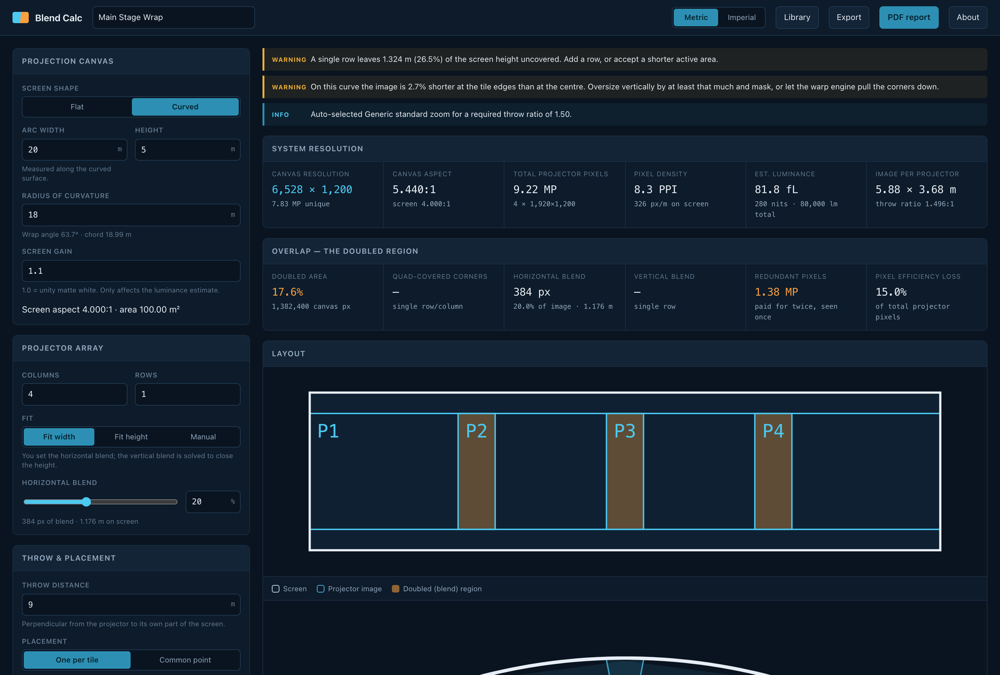

# Blend Calc user guide

Blend Calc is a projector edge-blend calculator that runs entirely in the browser. Define a
projection canvas, set the array, pick a projector and lens from a library you control, and get the
system resolution, the overlap budget, the lens requirement per position, a PDF report, and a
Resolume Arena advanced-output file.

There's no backend, so there are no accounts and no telemetry. Everything is worked out and stored
in the browser.

*A 20 m × 5 m cylindrical screen on an 18 m radius, four projectors wide at 20% blend. The warnings
are live: this array leaves 26.5% of the screen height uncovered, and the curve makes the image
2.7% shorter at the tile edges than at the centre.*

> **Before you rely on this:** the blend, pixel-budget and curved-optics maths is verified
> numerically. 66 tests pin the conservation invariants, the flat and curved limit cases and the
> lens-selection logic, and the PDF report has been generated and inspected across flat, curved,
> single-projector, large-array and broken-on-purpose designs.
>
> **The projector and lens specifications it ships with are seed data, flagged `unverified`
> throughout.** The Resolume exporter's vocabulary comes from real Arena 7.27.0 files, and CI checks
> that it invents nothing, but **it hasn't been round-tripped through a running Arena**, and **no
> blend has ever been driven onto real projectors from it.**
>
> This codebase was created with AI assistance, directed and reviewed by a human author.

---

## The canvas

**Flat or cylindrical.** On a curve you give the arc width (measured along the surface, the way a
screen is actually built) and the radius, and the wrap angle and chord fall out of that.

## The array, and which blend you pin

Any grid of columns × rows. You pin one blend and the solver works out the other, so the array
closes on the screen exactly:

| Fit mode | You set | Solver derives |
|---|---|---|
| **Fit width** | horizontal blend | vertical blend |
| **Fit height** | vertical blend | horizontal blend |
| **Manual** | both | reports the spill or shortfall instead of correcting it |

Manual is the mode to use when the rigging has fixed the array rather than the arithmetic. It tells
you what you're short by, rather than silently moving a projector for you.

---

## The doubled region, which is what makes blends expensive

Blend bands are covered by **two** projectors, and where a horizontal and a vertical blend cross, by
**four**.

The report separates all three cases, in canvas pixels and as a share of the canvas, and totals the
redundant pixels you pay for twice and see once.

That total is the number to take to a hire quote. It's also the number that decides whether a 2×2
array of one projector class beats a 1×4 of another.

---

## System resolution and light

The blended canvas size, total projector pixels, pixel density on the screen surface in PPI, and an
estimated screen luminance in foot-lamberts and nits.

Luminance is an estimate from the projector's rated output. It knows nothing about your screen gain,
ambient light or lamp hours.

---

## Throw and lens

Required throw ratio per column, the lens that covers it, **where it sits in its zoom range**, and
the horizontal lens shift needed.

There are two placement models, and they're quite different jobs:

- **One per tile:** each projector on the axis of its own tile. No shift needed.
- **Common point:** the whole array stacked at one position. Off-axis tiles need shift, and on a
  curve the throw varies per column.

"Where it sits in its zoom range" is the field to read before ordering. A lens at the very end of
its range is a lens with no adjustment left on site.

---

## Curved screens are not flat maths with a fudge factor

A projector forms a **flat** image and a curved screen isn't flat, so the flat image has to be
**wider than the tile's arc length** to reach around the curvature.

Two consequences the tool reports and a flat calculator misses:

- **You need a wider lens than the flat maths suggests.**
- **The image is shorter at the tile edges than at the centre**, because a concave screen's edges
  bulge towards the projector. You oversize vertically and mask, or let the warp engine pull the
  corners down. The percentage is on screen and in the report.

A projector at the centre of curvature (throw = radius) is a normal, often ideal position, and it's
handled. The actual constraint is that **the projector has to be in front of the plane through its
own tile's edges.**

---

## The library is yours

Projectors by brand and model with their native resolution, light output and lens mount, and
lenses grouped into **mount families**, so you enter them once rather than once per body.

It's fully editable, with JSON import and export, which is how you carry a hire company's actual
stock between machines.

**The data it ships with is seed data and is flagged unverified.** Check a spec against the
manufacturer before it decides a purchase.

---

## Exports

A PDF system report, a Resolume Arena advanced-output XML, and the design itself as JSON.

The Arena export only writes elements and attributes seen in real Arena files, and CI checks that it
invents none, but it's never been loaded back into a running Arena. Treat the first import as a
test.

---

## If something looks wrong

| Symptom | Cause |
| --- | --- |
| **The array does not cover the screen** | You are in Manual fit. It reports the shortfall rather than correcting it. |
| **The lens is at the end of its zoom** | Read the range field — that is what it is for. Choose another lens or move the array. |
| **The image is short at the tile edges** | A concave screen. Oversize vertically and mask, or warp. The percentage is reported. |
| **The pixel count is much higher than the canvas** | The doubled region. That is the cost of blending, itemised. |
| **A projector spec looks wrong** | It is seed data, flagged unverified. Edit the library. |
